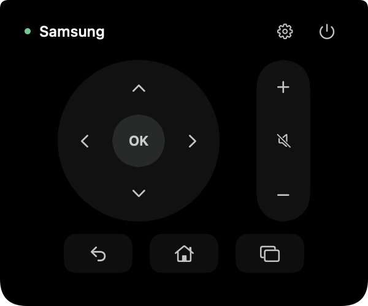

# TV Remote for Mac

A tiny, free, open-source TV remote that lives in your Mac’s menu bar.
Click the remote-shaped icon and the controls appear directly underneath it.
Click again, click outside, or press Escape to close. No Dock icon, hover activation, account, ads, or subscription.

**v0.1 supports Samsung only.** Requests for **any TV brand or model** are welcome—see [Request TV support](#request-tv-support).

[Download v0.1 for Apple silicon](https://github.com/momchilon/tv-remote-mac/releases/download/v0.1/TV-Remote-v0.1-arm64.dmg) · [All releases](https://github.com/momchilon/tv-remote-mac/releases) · [Request TV support](https://github.com/momchilon/tv-remote-mac/issues/new?template=tv-support.yml)



## Install

1. Download the DMG from [Releases](https://github.com/momchilon/tv-remote-mac/releases/latest).
2. Open it and drag **Notch Remote.app** into **Applications**.
3. Eject the DMG and open the app from Applications.
4. Click the remote-shaped icon in the menu bar.
5. Enter your Samsung TV’s local IPv4 address, click Connect, and choose **Allow** on the TV.

The Mac and TV must be on the same reachable local network. The app remembers the approved pairing on that Mac. No pairing tokens or personal TV settings are included in the download.

The app is still named **Notch Remote** internally for compatibility with early local builds. Despite that name, it is a **click-only menu-bar app**, not a notch app.

### Requirements and first launch

- The downloadable v0.1 DMG is for **Apple silicon Macs**, with a minimum deployment target of **macOS 13**. Not every macOS version has been physically tested.
- A compatible **Samsung smart TV** offering its local-network remote interface on port 8002. Support varies by model and firmware; not every Samsung TV has been tested.
- The release is **ad-hoc signed, not Apple-notarized**. macOS may require manual approval in Privacy & Security when opening a downloaded build. You can also inspect the source and build it yourself.
- It needs local-network access—not Accessibility, screen recording, or desktop-control permission.

## Controls

- Direction pad and OK
- Volume up/down and mute
- Back, Home and input selection
- Power-off with an explicit confirmation
- Keyboard arrows/Return while the remote is focused; Escape closes it

The gear opens connection settings. Right-click the menu-bar icon for connection settings or Quit. The app does not add itself to login items.

### New in source builds (unreleased)

- **Find TVs:** open the gear, click **Find TVs**, then select a discovered Samsung TV. Its name and IP fill the form; discovery does not pair with it or send remote commands. Click **Save & Connect** when ready.
- **Multiple remotes:** give each TV a name (for example, Living room or Bedroom). Use the TV-name menu above the controls to switch between saved TVs, or choose **Add TV** to set up another one.
- **Edit/remove:** click a saved TV in settings to edit its name; **Save & Connect** saves the change. The play button connects immediately. The row's menu removes the saved remote without deleting its pairing credentials; **Re-pair TV** explicitly clears pairing for the IP in the form.
- Saved remotes and the selected TV survive restarting the app. An existing single-TV setup is migrated automatically. Pairing remains separate for each IP address.

Discovery uses local IPv4 SSDP and a read-only Samsung device-information request on port 8001. Turn the TV on and allow local-network access in macOS. Guest Wi-Fi isolation, VPN routing, or blocked multicast can prevent discovery; manual IP entry remains available. Discovery does not sweep your subnet. Unsupported devices are not shown, and discovering a TV does not guarantee it supports every remote command.

TV names and device information discovered over HTTP are untrusted hints, not authentication. Control still uses the existing pinned TLS connection on port 8002. If discovery provides a valid MAC address, it is remembered only after a successful connection to that TV, enabling best-effort wake where supported.

These features are not included in the downloadable v0.1 release above; build from source to try them.

## Current limits

- **Samsung only in v0.1.** There is no LG, Sony, Philips, TCL, Hisense, Roku or Android/Google TV backend yet.
- The v0.1 download requires manual IP entry. Source builds also offer the **Find TVs** scan described above.
- No channel list, app launcher, screen mirroring, or cloud control.
- Waking the TV is best-effort and requires a known MAC address plus working standby networking. The v0.1 download has no automatic MAC discovery or MAC-entry field. Source builds can remember a MAC reported during discovery, but not every TV provides one. Turning an already-connected TV off is supported.
- A successful WebSocket write is not an acknowledgment that the TV acted on a key. Key behavior depends on the TV and its current screen.

## Request TV support

**You can request any TV brand or model.** Open a [TV support request](https://github.com/momchilon/tv-remote-mac/issues/new?template=tv-support.yml) and include:

- Brand and exact model
- Approximate model year and TV operating system, if known
- The controls you need
- Whether you can help test on the physical TV

Examples include LG/webOS, Sony, Philips, TCL, Hisense, Roku and Android/Google TV. Requests help prioritize future support; submitting one does not guarantee compatibility or a delivery date. Contributions and new TV backends are welcome.

**Do not post pairing tokens, serial numbers, MAC addresses, local IP addresses, or other private network information in public issues.**

## Build from source

Requires macOS, Xcode or compatible Apple Swift tools (**Swift 5.9+**), and Python 3 for the build scripts/tests. No third-party runtime libraries, package installs, or backend service.

```sh
git clone https://github.com/momchilon/tv-remote-mac.git
cd tv-remote-mac
python3 tools/build.py
python3 Tests/verify_bundle.py
```

Output: `dist/Notch Remote.app`. The local build targets the Mac’s architecture; the downloadable release is built on Apple silicon.

To package and verify a DMG without opening Finder or launching the app:

```sh
python3 tools/make_dmg.py
python3 Tests/verify_dmg.py
```

Output: `dist/TV Remote.dmg`. Packaging uses native macOS disk-image tools and hidden, read-only verification mounts.

## Tests

Default tests do not operate a real TV or control the desktop:

```sh
swift test
(cd RemoteKit && swift test --build-system native)
python3 Tests/test_release.py
```

`RemoteKit` integration tests use a temporary loopback TLS/WebSocket server, Python 3 and system OpenSSL. Port 8002 on loopback must be free; do not run those fixture tests concurrently. The `native` build-system option is deprecated on newer Swift toolchains but remains usable by this package.

UI tests are explicitly opt-in because they create status items, render windows and exercise popovers. Run them only in a desktop session you have permission to control:

```sh
RUN_UI_TESTS=1 swift test
```

The optional `RemoteCheck` diagnostic authenticates against a TV without sending remote keys; it may display a TV approval prompt and stores approved credentials. See [RemoteKit](RemoteKit/README.md).

## Privacy and security

- Local-network control only; no telemetry, accounts or cloud service.
- TLS on port 8002 with per-TV certificate pinning after first successful authentication. Changed certificates require explicit re-pairing. First-use trust cannot eliminate first-contact impersonation on an untrusted LAN.
- Pairing data is stored locally in `~/Library/Application Support/Notch Remote/connections.json`, with private file permissions. Do not publish this directory.
- Only the small remote-key allowlist is exposed. No factory-reset or service-menu commands.

## Contributing and license

See [CONTRIBUTING.md](CONTRIBUTING.md). Source code is released under the [MIT License](LICENSE).
This is an independent community project, not affiliated with or endorsed by Samsung or Apple.
